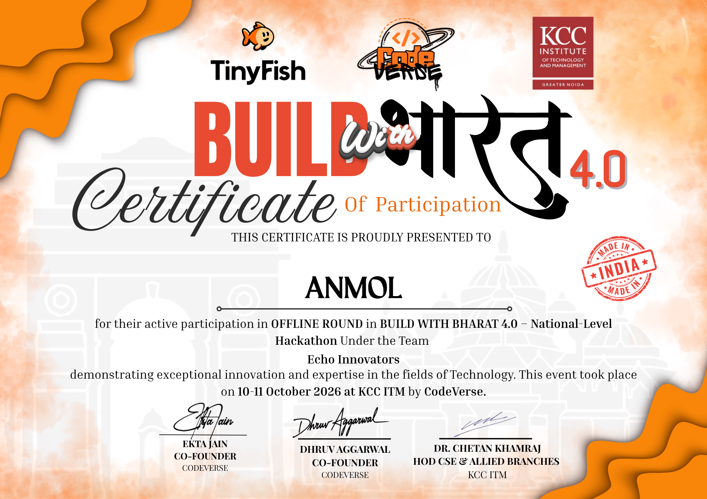

# Hi, I'm Anmol! 👋

I am a 1st-year **B.Tech CSE (AI & ML) student at Galgotias University**. I am passionate about learning Artificial Intelligence, Machine Learning, and building innovative software solutions.

## 🛠️ Tech Stack & Skills
- **Languages:** Python
- **Web Development:** HTML, CSS, JavaScript
- **Tools:** Git, GitHub, VS Code
- **Interests:** Machine Learning algorithms, Data Structures

## 🏅 Hackathon & Achievements

- **Participant at Hack 'em Hex Hackathon (IEEE)** - Developed a conceptual framework for an "AI-Powered Personalized Smart Study Planner".
  [View my Hack 'em Hex Participation certificate](hackem-hex-cert.png.pdf)

- **Participant at Build With Bharat 4.0** - Developed a "Smart Traffic Light Management System".
   
  
   

- **Participant at HEALTHNOVA 2026** - IEEE EMBS Bioengineering Innovation Challenge with Team "Quantum Coders".
   
  
## 📈 My Coding Journey
- Currently building foundation skills in Python and foundational Machine Learning concepts.
- Open to collaboration on college-level coding projects and upcoming hackathons!
-
